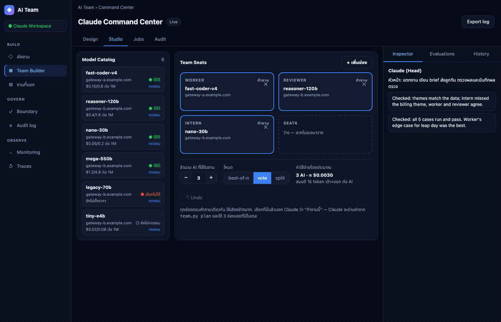
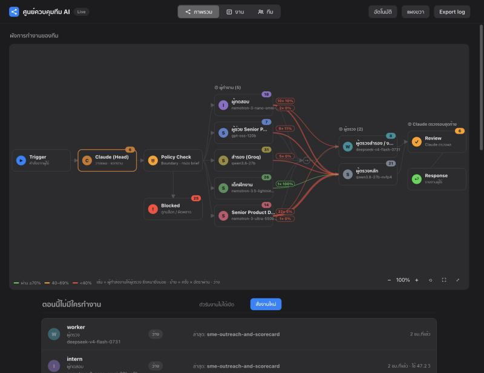
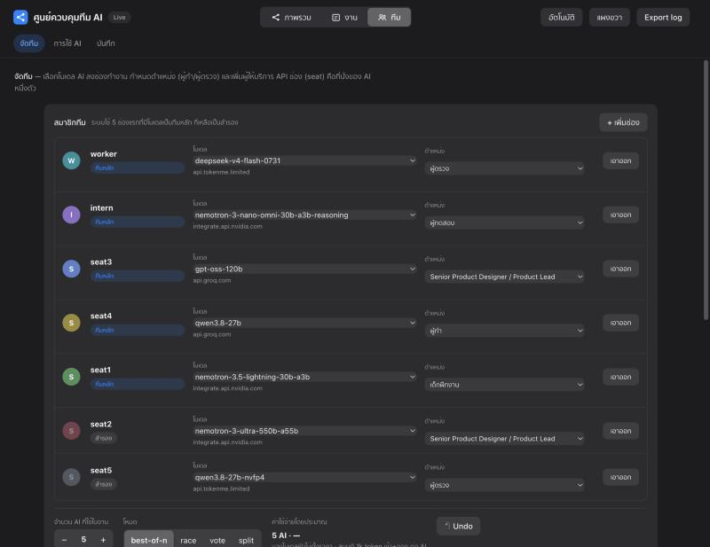
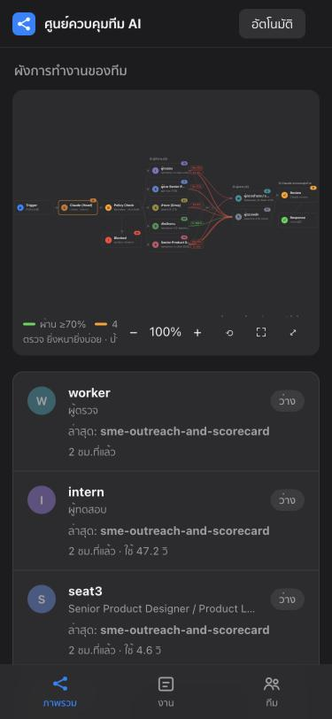
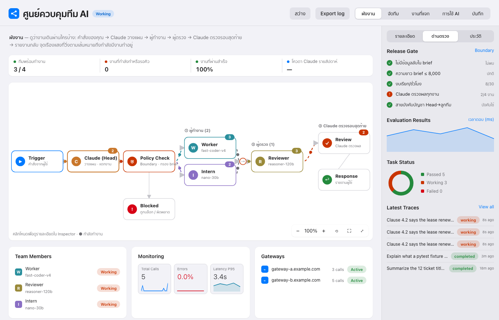
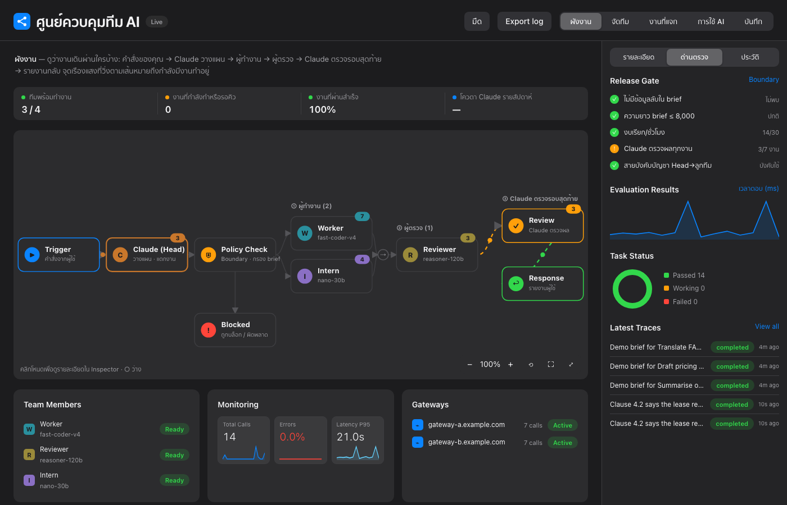
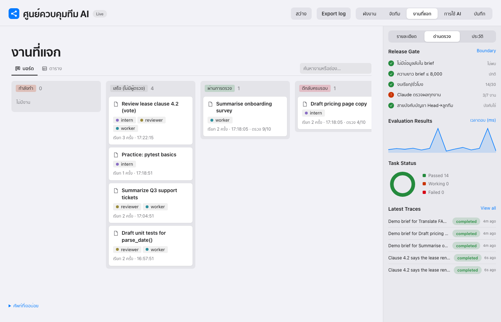
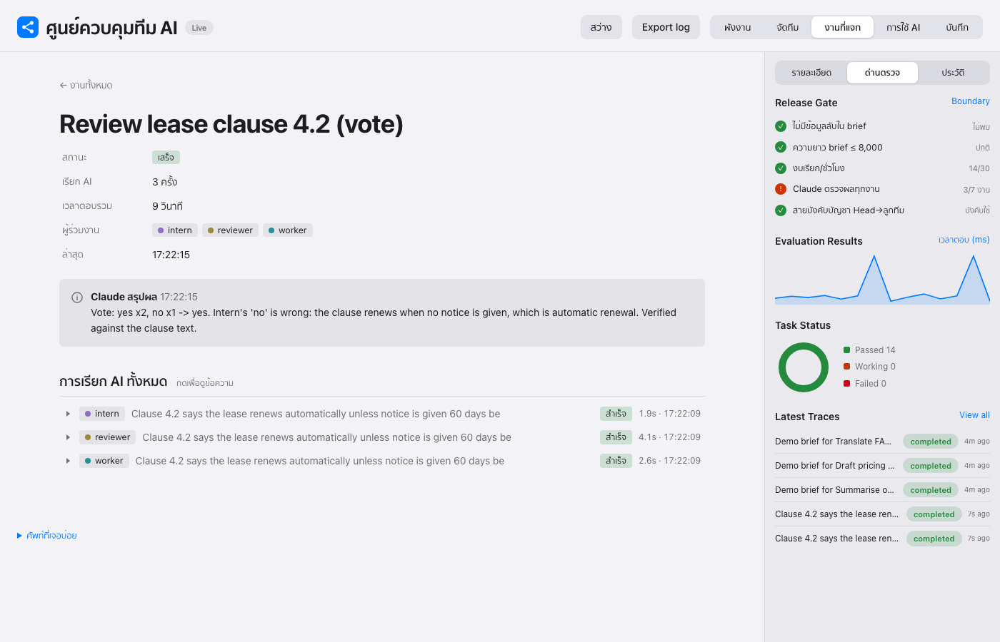
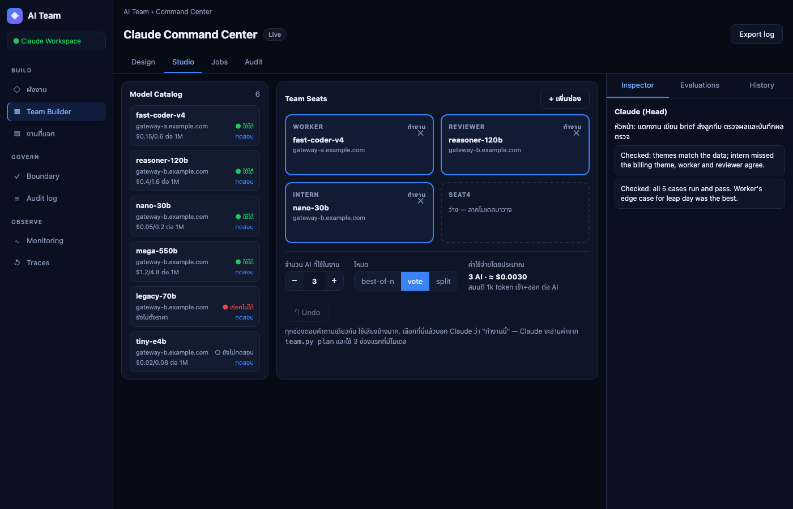
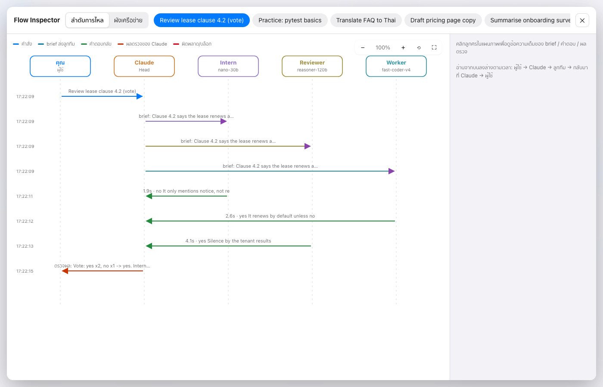

# Power AI Ranger — a Claude Code skill that turns Claude into the Head of a multi-AI team

**English** · [ไทย](README.th.md) · [简体中文](README.zh-CN.md)

Let Claude Code act as the **Head** of an AI team: it plans the work, splits it into briefs, sends them to other models (DeepSeek, NVIDIA Nemotron, Qwen, gpt-oss, or any **OpenAI-compatible API**), reviews the results, and reports back. A safety boundary filters what leaves your machine, and a live dashboard shows who is doing what.

**▶ Launch video (21s):** click the image to play

[](docs/video/power-ai-ranger.mp4)



> Screenshots and the GIF are generated from made-up demo data (`scripts/demo_seed.py`). No real keys or gateways are shown. Regenerate with `scripts/capture_demo.sh docs`.

## Screenshots


*Overview: live team flow map — who sent work to whom, pass rate per pair*

<p> </p>

*Team page: pick a model and role per seat from dropdowns · Mobile*

## Why use it
- You already pay for or have access to several models (free tiers, API gateways, local servers) but run them one at a time.
- You want a **maker → reviewer** workflow, parallel jobs, and an audit trail without writing an orchestration framework.
- You want guardrails: no API keys or ID numbers in prompts, call limits, and a log of every request.

## Features
- **Claude as Head** — you talk to Claude in chat; it breaks the task down, writes briefs, checks results, and reports.
- **Team Builder** — drag models from a catalog into team seats, choose roles (maker, reviewer, tester, editor, Senior PD…), how many AIs per job, and the mode (`best-of-n`, `vote`, `split`). Add providers (Tokenme, OpenRouter, NVIDIA NIM, Groq, or custom) from the web UI.
- **Parallel queue + maker→reviewer flow** — reviewers sit in a different seat (ideally a different gateway) and can send work back for several rounds, with automatic checks (JSON, regex, code run in a sandbox).
- **Skill-based routing** — every seat has per-skill scores (`team.py skills ls`); `--pool @auto --needs <skill>` picks the best seat, and scores update from real results.
- **Race mode (speed)** — `team.py race on --n 2 --hedge 6`: the fastest seat starts first; if it is slow or fails, the next seat starts and the first valid answer wins. Reviewers that return malformed JSON are skipped automatically. Ties in skill score go to the faster seat.
- **Boundary** — filters keys/passwords, limits length and calls per hour, refuses placeholder URLs, logs everything.
- **Live dashboard** — flow diagram of who works on what, with a glowing frame on every AI that is working right now; a Notion-style job board; usage and latency; audit log; light/dark mode.
- **Web search for the team** — `team.py web search|fetch` (TinyFish) feeds sourced facts to the models without exposing your key.
- **Merge + research pipelines** — an `editor` role merges multi-part work; `team.py research` runs a problem-first research flow.
- **Training and per-member guides** — `scripts/train.py` measures each member on held-out tasks, writes coaching prompts, and generates portable per-member instruction files (`docs/team/`) you can reuse in other projects or sessions. See `docs/TEAM-GUIDE.md`.

| Flow (light) | Flow (dark) |
|---|---|
|  |  |
| **Job board** | **Job page** |
|  |  |
| **Team builder** | **Flow inspector** |
|  |  |

## Use ChatGPT, Gemini or Grok as team members

Any OpenAI-compatible provider works. Seven presets are built in:

```bash
python3 scripts/team.py presets                    # list presets and their key env var names
python3 scripts/team.py connect gemini             # asks for the key silently, imports Gemini models
python3 scripts/team.py connect openai --seat seat6  # ChatGPT models, put the first one in seat6
AI_TEAM_KEY_XAI=... python3 scripts/team.py connect xai   # Grok, key from env (for scripts/CI)
```

| Preset | Provider | Key env var |
|---|---|---|
| `openai` | ChatGPT (OpenAI) | `AI_TEAM_KEY_OPENAI` |
| `gemini` | Gemini (Google AI Studio) | `AI_TEAM_KEY_GEMINI` |
| `xai` | Grok (xAI) | `AI_TEAM_KEY_XAI` |
| `groq`, `openrouter`, `nvidia`, `tokenme` | others | `AI_TEAM_KEY_<NAME>` |

A key that fails is not saved. Keys stay in your local `team.db` and are never printed.

### Use the AI subscriptions already on your computer (no API key)

If you're logged in to an AI coding CLI, the team can use that login as a seat. Calls count against your monthly plan instead of per-token API billing.

```bash
python3 scripts/team.py connect codex-cli --seat seat6     # ChatGPT plan via Codex CLI (models from your Codex cache)
python3 scripts/team.py connect agy-cli                    # Antigravity CLI (agy)
python3 scripts/team.py connect claude-cli                 # Claude Code
python3 scripts/team.py connect gemini-cli                 # Gemini CLI
```

Each call runs in an empty temp folder in plan/read-only mode with no saved session, so a seat can only return text and can't edit files. A short task per call is cheaper than one long shared session, because a session re-sends its whole history every turn. Known limits: Google no longer lets personal accounts use Gemini CLI and points them to Antigravity. If your `agy` uses a custom `modelProvider`, set the env var that provider needs.

### Drive it from any agent CLI (Antigravity, Gemini CLI, Codex…)

The team is a plain CLI, so any agent that can run shell commands can lead it. Point the agent at [`AGENTS.md`](AGENTS.md).

## Quick start
```bash
# 1. Install as a Claude Code skill
git clone https://github.com/panusbodee-owen/Power-Ai-Ranger-Skill.git ~/.claude/skills/ai-team

# 2. Register team members (you type the key in your own terminal; it is asked silently)
python3 ~/.claude/skills/ai-team/scripts/team.py add worker --base-url https://GATEWAY/v1 --model MODEL --role "Diligent worker"
python3 ~/.claude/skills/ai-team/scripts/team.py add intern --base-url https://GATEWAY/v1 --model MODEL --role "Intern"

# 3. Open the dashboard
python3 ~/.claude/skills/ai-team/scripts/dash.py   # http://localhost:8790
```
Then open Claude Code and just ask, e.g. "have worker write tests for this function". Claude plans, briefs the team, reviews, and reports.

API keys are stored in `~/.ai-team/team.db` on your machine only (not in this repo; `*.db` is git-ignored).

## Per-member guides and training
- `docs/TEAM-GUIDE.md` and `docs/team/<name>.md` — system prompt, coaching text, example briefs and a runnable `curl`/Python call for each member. No API keys.
- `docs/performance-*.md` — before/after results with their limits. The models are hosted, so nothing is fine-tuned: "training" here means a coaching prompt plus measurement.
- Rebuild: `python3 scripts/train.py run && python3 scripts/train.py apply && python3 scripts/train.py report docs/performance-<date>.md && python3 scripts/train.py guide docs/team`

## Security
- Claude never reads or prints your API keys; they are used by the scripts only.
- Briefs are filtered for keys, passwords and 13-digit numbers; length and hourly call counts are limited; every call is logged.
- The dashboard binds to 127.0.0.1 only and never reads the key column. It can edit seats and submit jobs, so do not expose that port to a network.
- Briefs and keys are sent to the gateways you configure. Pick providers you trust.

## Status
Early-stage and used daily by its author. Issues and pull requests are welcome.

If it is useful to you, a ⭐ on the repo helps others find it.

## Keywords
Claude Code skill · multi-agent orchestration · LLM team · maker/reviewer workflow · OpenAI-compatible API · DeepSeek · NVIDIA Nemotron · Qwen · Groq · OpenRouter · AI dashboard · prompt boundary
