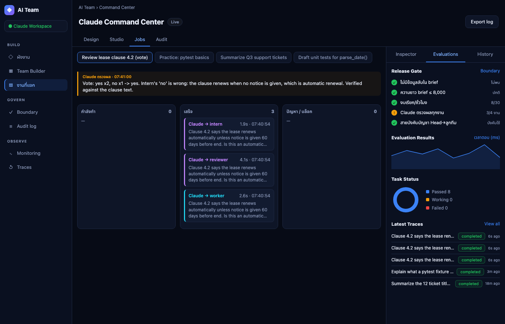
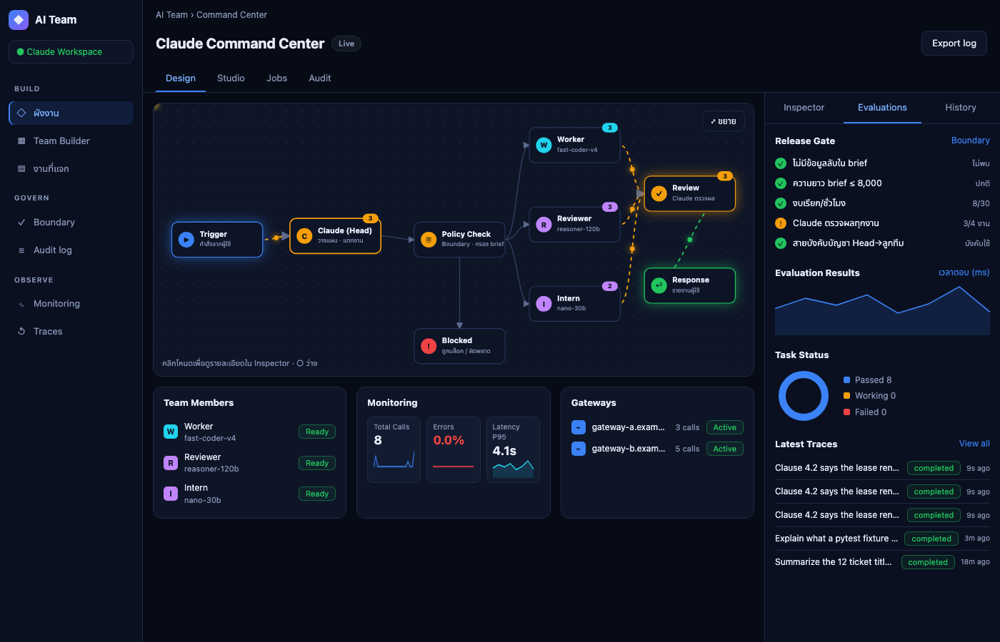

# ai-team

Skill สำหรับ Claude Code: ให้ Claude เป็นหัวหน้าที่สั่งงาน AI ตัวอื่น (DeepSeek, Nemotron หรืออะไรก็ได้ที่เป็น API แบบ OpenAI-compatible) พร้อม boundary และแดชบอร์ดดูการแจกงานสด


> ภาพและ GIF สร้างจากข้อมูลเดโมที่สมมติขึ้น (`scripts/demo_seed.py`) ไม่มี key หรือเกตเวย์จริง สร้างใหม่ได้ด้วย `scripts/capture_demo.sh docs`

## ฟีเจอร์
- **Claude เป็น Head**: คุณสั่งในแชท Claude แตกงาน เขียน brief ส่งลูกทีม ตรวจผล และรายงาน
- **Team Builder**: ลากโมเดลจากแคตตาล็อกไปวางในช่องทีม เลือกจำนวน AI ต่องานและโหมด (`best-of-n`, `vote`, `split`) พร้อมประเมินค่าใช้จ่าย
- **Boundary**: กรอง key/รหัสผ่าน, จำกัดความยาว/จำนวนครั้ง, กันส่ง key ไป URL ตัวอย่าง, บันทึกทุกครั้ง
- **แดชบอร์ดสด**: ผังโหนด, สถานะกำลังทำงาน, กระดานงาน, Release Gate, Audit log

| Design (ทีมกำลังทำงาน) | Studio (ลากโมเดลใส่ช่อง) |
|---|---|
|  |  |
| **Jobs (ผลตรวจของ Claude)** | **Design (เสร็จแล้ว)** |
|  |  |

**Flow Inspector (กดปุ่ม ⤢ ขยาย บนผัง)**: หน้าต่างเต็มจอ ดูว่างานไหลจากใครไปหาใคร แผนภาพลำดับตามเวลา (ผู้ใช้ → Claude → ลูกทีม → กลับ Claude → ผู้ใช้) คลิกลูกศรเพื่อดู brief/คำตอบ/ผลตรวจเต็ม สลับเป็นผังเครือข่ายขนาดใหญ่ได้ กด Esc เพื่อปิด


## ติดตั้ง
```bash
git clone <repo-url> ~/.claude/skills/ai-team
```

## ตั้งค่าลูกทีม (ทำเองในเทอร์มินัล)
API key ถูกถามแบบซ่อน และเก็บใน `~/.ai-team/team.db` (ไม่อยู่ใน repo นี้ และ `.gitignore` กัน `*.db` ไว้)
```bash
python3 ~/.claude/skills/ai-team/scripts/team.py add worker --base-url https://GATEWAY/v1 --model MODEL --role "พนักงานที่แข็งขัน"
python3 ~/.claude/skills/ai-team/scripts/team.py add intern --base-url https://GATEWAY/v1 --model MODEL --role "เด็กฝึกงาน"
```

## ใช้งาน
เปิด Claude Code แล้วสั่งตามปกติ เช่น "ให้ worker เขียนเทสต์ให้ฟังก์ชันนี้" Claude จะแตกงาน ส่ง brief ตรวจผล และรายงาน

แดชบอร์ด: `python3 ~/.claude/skills/ai-team/scripts/dash.py` แล้วเปิด http://localhost:8790

## ความปลอดภัย
- Claude ไม่อ่านหรือพิมพ์ API key ใช้ผ่านสคริปต์เท่านั้น
- brief ถูกกรอง key/รหัสผ่าน/เลข 13 หลัก จำกัดความยาวและจำนวนครั้ง และบันทึกทุกครั้ง
- แดชบอร์ดเปิดที่ 127.0.0.1 อ่านอย่างเดียว และไม่เคยอ่านคอลัมน์ key
- brief และ key ถูกส่งไปยังเกตเวย์ที่คุณตั้งค่า เลือกผู้ให้บริการที่ไว้ใจได้
