# ai-team (Power AI Ranger)

[English](README.md) · **ไทย** · [简体中文](README.zh-CN.md)

Skill สำหรับ Claude Code: ให้ Claude เป็นหัวหน้าที่สั่งงาน AI ตัวอื่น (DeepSeek, Nemotron หรืออะไรก็ได้ที่เป็น API แบบ OpenAI-compatible) พร้อม boundary และแดชบอร์ดดูการแจกงานสด

**▶ วิดีโอแนะนำ (21 วิ):** กดที่ภาพเพื่อเล่น

[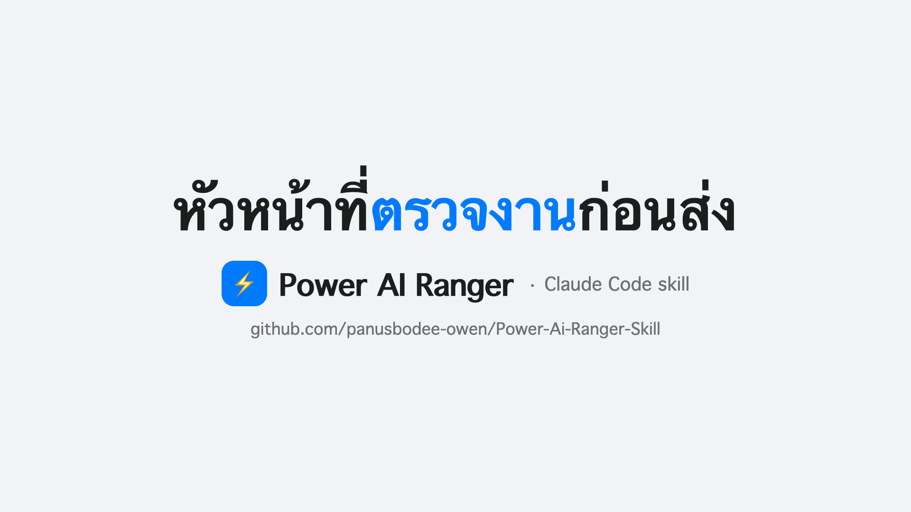](docs/video/power-ai-ranger.mp4)

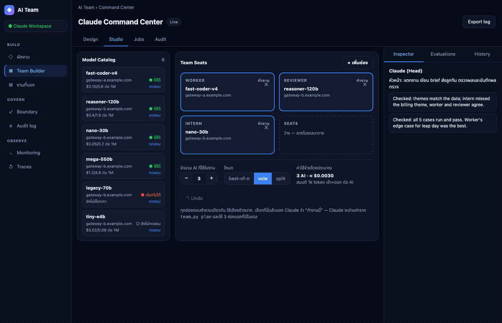

> ภาพและ GIF สร้างจากข้อมูลเดโมที่สมมติขึ้น (`scripts/demo_seed.py`) ไม่มี key หรือเกตเวย์จริง สร้างใหม่ได้ด้วย `scripts/capture_demo.sh docs`

## ภาพหน้าจอ

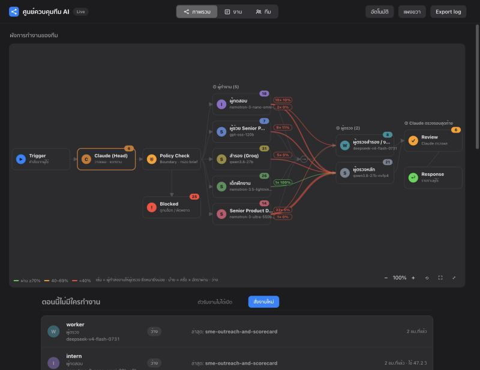
*ภาพรวม: ผังการทำงานของทีมแบบสด ใครส่งงานให้ใคร อัตราผ่านของแต่ละคู่*

<p>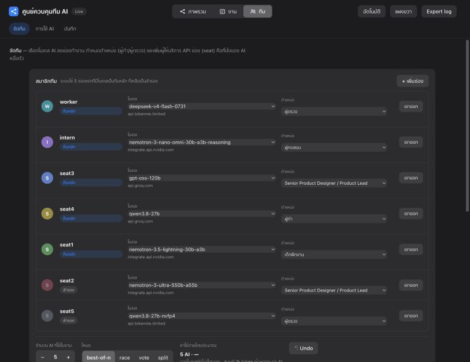 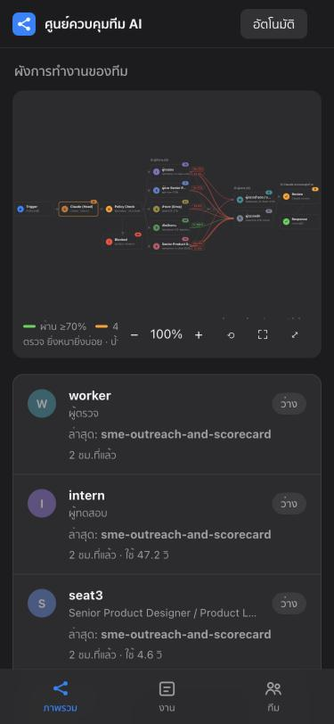</p>

*หน้าจัดทีม: เลือกโมเดลและตำแหน่งของแต่ละช่องจากเมนู · มือถือ*

## ฟีเจอร์
- **Claude เป็น Head**: คุณสั่งในแชท Claude แตกงาน เขียน brief ส่งลูกทีม ตรวจผล และรายงาน
- **Team Builder (แท็บ "จัดทีม")**: ลากโมเดลจากแคตตาล็อกไปวางในช่องทีม เลือกตำแหน่ง (ผู้ทำ/ผู้ตรวจ/ผู้ทดสอบ/Senior PD ฯลฯ) จำนวน AI ต่องาน และโหมด (`best-of-n`, `vote`, `split`) เพิ่มผู้ให้บริการ API (Tokenme, OpenRouter, NVIDIA, Groq หรือกำหนดเอง) ได้จากหน้าเว็บ
- **คิวงานขนาน + flow ผู้ทำ→ผู้ตรวจ**: ส่งงานเป็นชุดพร้อมกัน ผู้ตรวจต้องเป็นคนละช่อง (ถ้าเป็นไปได้ต่างเกตเวย์) ตีกลับให้แก้ได้หลายรอบ และมีตัวเช็กอัตโนมัติ (json, regex, โค้ดรันใน sandbox)
- **จัดคนตามความถนัด**: ทุกช่องมีคะแนนความถนัดต่อประเภทงาน (`team.py skills ls`) ใช้ `--pool @auto --needs <skill>` ให้ระบบเลือกช่องเอง และคะแนนปรับตามผลจริง
- **โหมดแข่งกัน (เร็วขึ้น)** — `team.py race on --n 2 --hedge 6`: ช่องที่เร็วสุดเริ่มก่อน ถ้าช้าหรือล้มจะเริ่มช่องถัดไป ใช้คำตอบแรกที่ใช้ได้ ผู้ตรวจที่ตอบ JSON พังจะถูกข้ามอัตโนมัติ และถ้าคะแนนความถนัดเท่ากันจะเลือกช่องที่เร็วกว่า
- **Boundary**: กรอง key/รหัสผ่าน, จำกัดความยาว/จำนวนครั้ง, กันส่ง key ไป URL ตัวอย่าง, บันทึกทุกครั้ง
- **แดชบอร์ด**: ผังงานตามลำดับจริง (ผู้ทำ → ผู้ตรวจ → Claude), **งานที่แจก** แบบ Notion (บอร์ด/ตาราง/หน้ารายละเอียด), **การใช้ AI** (จำนวนครั้ง เวลาตอบ อัตราผ่านการตรวจ และโทเคนของ Claude นับจากไฟล์บนเครื่อง), Audit log
- **โหมดสี**: อัตโนมัติ (ตามเครื่อง) / สว่าง / มืด สไตล์ระบบของ Apple

| ผังงาน (สว่าง) | ผังงาน (มืด) |
|---|---|
| 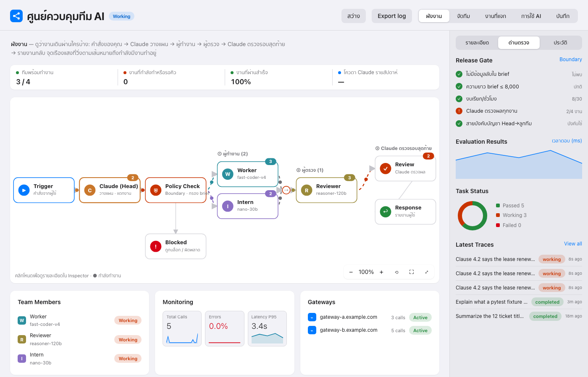 | 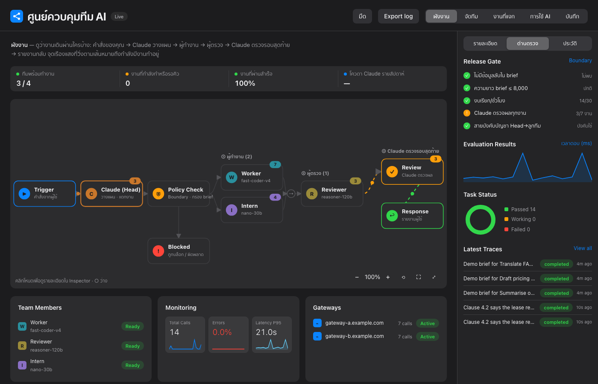 |
| **งานที่แจก: บอร์ด** | **งานที่แจก: หน้ารายละเอียด** |
| 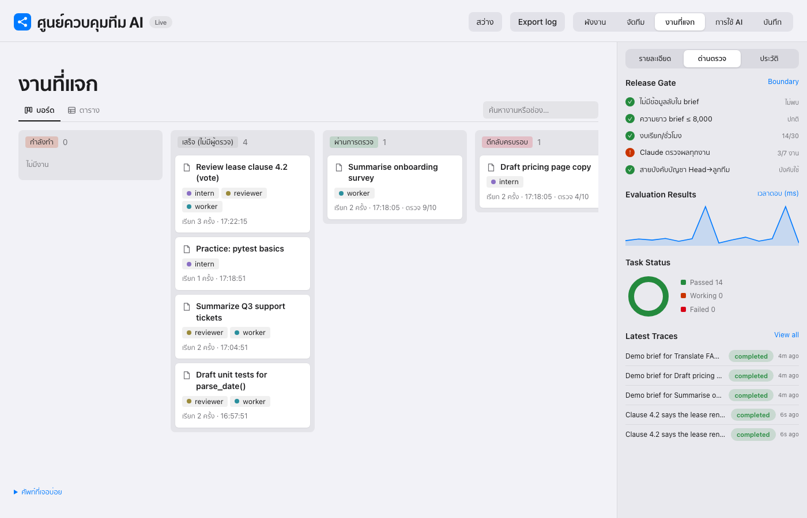 | 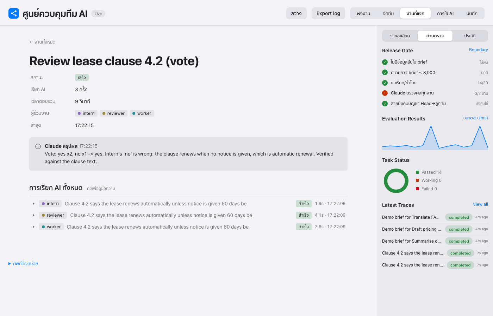 |
| **จัดทีม** | **Flow Inspector** |
| 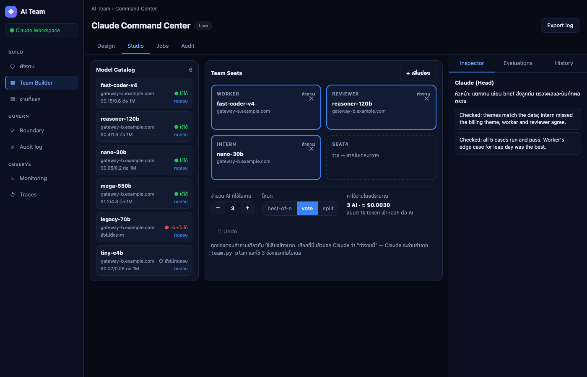 | 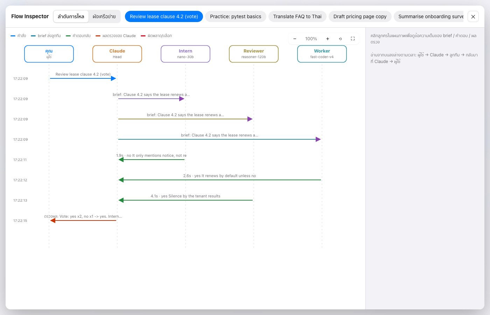 |

> ภาพและ GIF สร้างจากข้อมูลเดโมที่สมมติขึ้น (`scripts/demo_seed.py`) ไม่มี key หรือเกตเวย์จริง สร้างใหม่ได้ด้วย `scripts/capture_demo.sh docs` หน้า "การใช้ AI" ไม่ได้ถ่ายภาพ เพราะแสดงตัวเลขโทเคนจริงจากเครื่อง

**Flow Inspector (กดปุ่มขยายบนผัง)**: หน้าต่างเต็มจอ ดูว่างานไหลจากใครไปหาใคร แผนภาพลำดับตามเวลา คลิกลูกศรเพื่อดู brief/คำตอบ/ผลตรวจเต็ม สลับเป็นผังเครือข่ายได้ ซูมเข้า/ออกได้ (ปุ่ม − / + / รีเซ็ต / พอดีหน้าจอ, คีย์ `+` `-` `0` `F`, Ctrl/⌘ + ล้อเมาส์ หรือ pinch, ลากเพื่อเลื่อน) กด Esc เพื่อปิด

## ใช้ ChatGPT, Gemini หรือ Grok เป็นลูกทีม

ใช้ได้กับผู้ให้บริการที่รองรับรูปแบบ OpenAI ทุกเจ้า มีแบบสำเร็จรูป 7 เจ้า:

```bash
python3 scripts/team.py presets                      # รายชื่อและชื่อตัวแปร key
python3 scripts/team.py connect gemini               # ถาม key แบบซ่อน แล้วนำเข้าโมเดล Gemini
python3 scripts/team.py connect openai --seat seat6  # โมเดล ChatGPT ใส่ตัวแรกลงช่อง seat6
AI_TEAM_KEY_XAI=... python3 scripts/team.py connect xai   # Grok อ่าน key จาก env
```

| ชื่อ | ผู้ให้บริการ | ตัวแปร key |
|---|---|---|
| `openai` | ChatGPT (OpenAI) | `AI_TEAM_KEY_OPENAI` |
| `gemini` | Gemini (Google AI Studio) | `AI_TEAM_KEY_GEMINI` |
| `xai` | Grok (xAI) | `AI_TEAM_KEY_XAI` |
| `groq`, `openrouter`, `nvidia`, `tokenme` | อื่นๆ | `AI_TEAM_KEY_<NAME>` |

key ที่เชื่อมต่อไม่ผ่านจะไม่ถูกบันทึก key เก็บใน `team.db` บนเครื่องเท่านั้นและไม่ถูกพิมพ์ออกมา

### ใช้แพ็กเกจ AI ที่ล็อกอินไว้บนเครื่อง (ไม่ต้องใช้ API key)

ถ้าล็อกอิน CLI ของ AI ไว้แล้ว ทีมใช้บัญชีนั้นเป็นลูกทีมได้เลย ค่าใช้จ่ายนับจากโควตาแพ็กเกจรายเดือน ไม่ได้เสียค่า token แยก

```bash
python3 scripts/team.py connect codex-cli --seat seat6     # แพ็กเกจ ChatGPT ผ่าน Codex CLI
python3 scripts/team.py connect agy-cli                    # Antigravity CLI (agy)
python3 scripts/team.py connect claude-cli                 # Claude Code
python3 scripts/team.py connect gemini-cli                 # Gemini CLI
```

ทุกครั้งที่เรียก ระบบรันในโฟลเดอร์ว่างชั่วคราว โหมดอ่านอย่างเดียว และไม่เก็บ session ลูกทีมจึงตอบได้แค่ข้อความ แก้ไฟล์ไม่ได้ การส่งงานสั้นทีละชิ้นถูกกว่าคุยต่อใน session ยาว เพราะ session จะส่งประวัติทั้งหมดซ้ำทุกครั้ง ข้อจำกัดที่รู้แล้ว: Google ไม่ให้บัญชีส่วนตัวใช้ Gemini CLI แล้วและแนะนำให้ย้ายไป Antigravity ส่วน `agy` ที่ตั้ง `modelProvider` เองต้องใส่ตัวแปร env ของผู้ให้บริการนั้น

### สั่งงานผ่าน agent CLI ตัวอื่น (Antigravity, Gemini CLI, Codex…)

ทีมเป็น CLI ธรรมดา agent ตัวไหนที่รันคำสั่ง shell ได้ก็เป็นหัวหน้าทีมได้ ให้ agent อ่าน [`AGENTS.md`](AGENTS.md)

## ติดตั้ง
```bash
git clone <repo-url> ~/.claude/skills/ai-team
```

## ตั้งค่าลูกทีม (ทำเองในเทอร์มินัล)
API key ถูกถามแบบซ่อน และเก็บใน `~/.ai-team/team.db` (ไม่อยู่ใน repo นี้ และ `.gitignore` กัน `*.db` ไว้)
```bash
python3 ~/.claude/skills/ai-team/scripts/team.py add worker --base-url https://GATEWAY/v1 --model MODEL --role "พนักงานที่แข็งขัน"
python3 ~/.claude/skills/ai-team/scripts/team.py add intern --base-url https://GATEWAY/v1 --model MODEL --role "เด็กฝึกงาน"
```

## ใช้งาน
เปิด Claude Code แล้วสั่งตามปกติ เช่น "ให้ worker เขียนเทสต์ให้ฟังก์ชันนี้" Claude จะแตกงาน ส่ง brief ตรวจผล และรายงาน

แดชบอร์ด: `python3 ~/.claude/skills/ai-team/scripts/dash.py` แล้วเปิด http://localhost:8790

## ความปลอดภัย
- Claude ไม่อ่านหรือพิมพ์ API key ใช้ผ่านสคริปต์เท่านั้น
- brief ถูกกรอง key/รหัสผ่าน/เลข 13 หลัก จำกัดความยาวและจำนวนครั้ง และบันทึกทุกครั้ง
- แดชบอร์ดเปิดที่ 127.0.0.1 เท่านั้น และไม่เคยอ่านคอลัมน์ key แต่แก้ช่องทีมและส่งงานได้ ห้ามเปิดพอร์ตนี้ให้เครือข่ายภายนอก
- brief และ key ถูกส่งไปยังเกตเวย์ที่คุณตั้งค่า เลือกผู้ให้บริการที่ไว้ใจได้

## คู่มือสั่งงานรายคน และผลเทรน
- `docs/TEAM-GUIDE.md` และ `docs/team/<ชื่อ>.md`: system prompt, คู่มือ (coaching), ตัวอย่างคำสั่ง และ curl/Python ของสมาชิกแต่ละคน (ไม่มี API key) ใช้ต่อในโปรเจกต์หรือเซสชันอื่นได้
- `docs/performance-*.md`: รายงานผลเทรนก่อน/หลัง พร้อมข้อจำกัด (โมเดลเป็นบริการโฮสต์ ไม่มีการ fine-tune "เทรน" = คู่มือในพรอมต์ + การวัดผล)
- สร้างใหม่: `python3 scripts/train.py run && python3 scripts/train.py apply && python3 scripts/train.py report docs/performance-<วันที่>.md && python3 scripts/train.py guide docs/team`

## สนับสนุนโปรเจกต์
ถ้ามีประโยชน์ กดดาว ⭐ ให้ได้ที่มุมขวาบนของหน้า repo และเปิด Issue ได้เลยถ้าเจอปัญหาหรืออยากได้ฟีเจอร์
