# Power AI Ranger — 让 Claude 成为多 AI 团队负责人的 Claude Code 技能

[English](README.md) · [ไทย](README.th.md) · **简体中文**

让 Claude Code 担任 AI 团队的 **负责人（Head）**：Claude 负责规划任务、拆分成工作说明（brief）、分发给其他模型（DeepSeek、NVIDIA Nemotron、Qwen、gpt-oss，或任何 **兼容 OpenAI 的 API**），再审核结果并向你汇报。内置安全边界（boundary）过滤离开本机的内容，并提供实时仪表盘，显示每个 AI 正在做什么。

**▶ 介绍视频（21 秒）：** 点击图片播放

[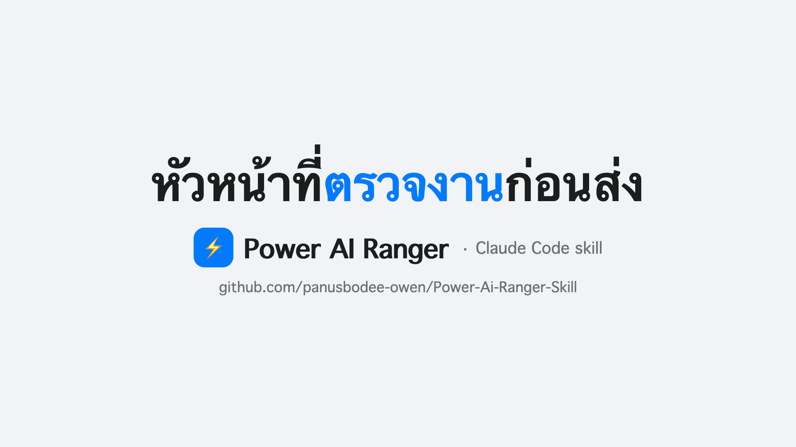](docs/video/power-ai-ranger.mp4)

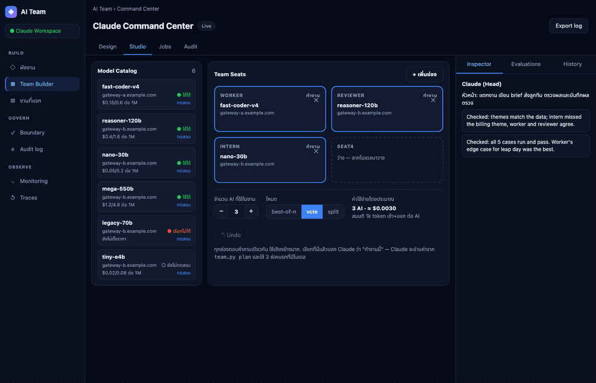

> 截图和 GIF 由虚构的演示数据生成（`scripts/demo_seed.py`），不含任何真实密钥或网关。可用 `scripts/capture_demo.sh docs` 重新生成。

## 截图

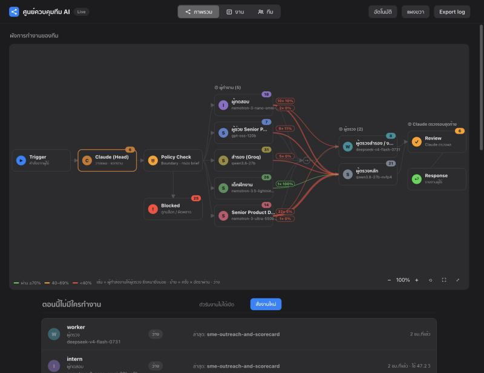
*总览：团队实时流程图，谁把任务交给谁、每对的通过率*

<p>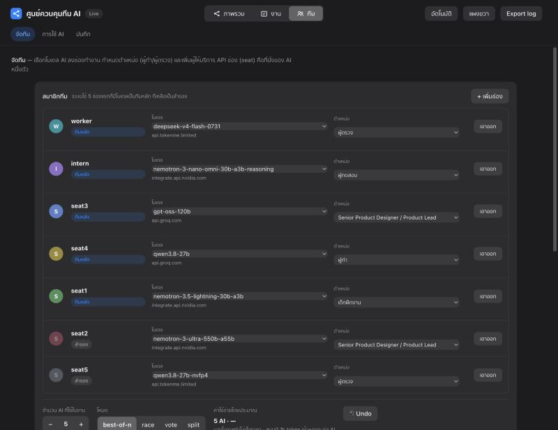 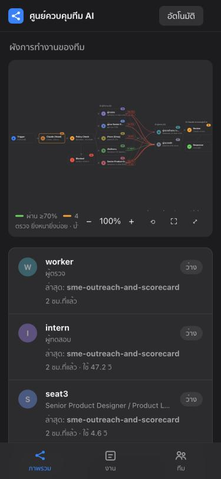</p>

*团队页：通过下拉菜单为每个席位选择模型和角色 · 移动端*

## 适合谁
- 你有多个模型的访问权限（免费额度、API 网关、本地服务），但一次只能用一个。
- 你想要 **执行者 → 审核者** 的工作流、并行任务和审计记录，又不想自己写一套编排框架。
- 你需要防护措施：提示词中不能出现 API 密钥或身份证号，限制调用次数，并记录每一次请求。

## 功能
- **Claude 作为负责人**：你在聊天里下达任务，Claude 拆解任务、撰写 brief、检查结果并汇报。
- **团队构建器**：把模型从目录拖到团队席位，选择角色（执行者、审核者、测试员、编辑、资深产品设计等）、每个任务使用的 AI 数量以及模式（`best-of-n`、`vote`、`split`）。可在网页上添加服务商（Tokenme、OpenRouter、NVIDIA NIM、Groq 或自定义）。
- **并行队列 + 执行者→审核者流程**：审核者位于不同席位（最好是不同网关），可多轮退回修改，并支持自动检查（JSON、正则、沙箱中运行代码）。
- **按技能分配任务**：每个席位都有分技能评分（`team.py skills ls`），用 `--pool @auto --needs <skill>` 自动选择最合适的席位，评分会根据真实结果更新。
- **竞速模式（更快）**：`team.py race on --n 2 --hedge 6`。最快的席位先开始，如果太慢或失败，就启动下一个席位，采用第一个有效答案。审核者返回格式错误的 JSON 会被自动跳过。技能评分相同时优先选择更快的席位。
- **安全边界**：过滤密钥/密码，限制长度和每小时调用次数，拒绝示例占位 URL，记录所有调用。
- **实时仪表盘**：展示任务流向的流程图，正在工作的 AI 会有发光边框；Notion 风格的任务看板；使用量与延迟；审计日志；明暗模式。
- **团队联网搜索**：`team.py web search|fetch`（TinyFish）为模型提供带来源的事实，不暴露你的密钥。
- **合并与调研流水线**：`editor` 角色合并多部分工作；`team.py research` 运行“从问题出发”的调研流程。
- **训练与成员指南**：`scripts/train.py` 在留出的任务上评估每位成员，生成辅导提示词，并输出可移植的成员指令文件（`docs/team/`），可在其他项目或会话中复用。见 `docs/TEAM-GUIDE.md`。

| 流程图（浅色） | 流程图（深色） |
|---|---|
| 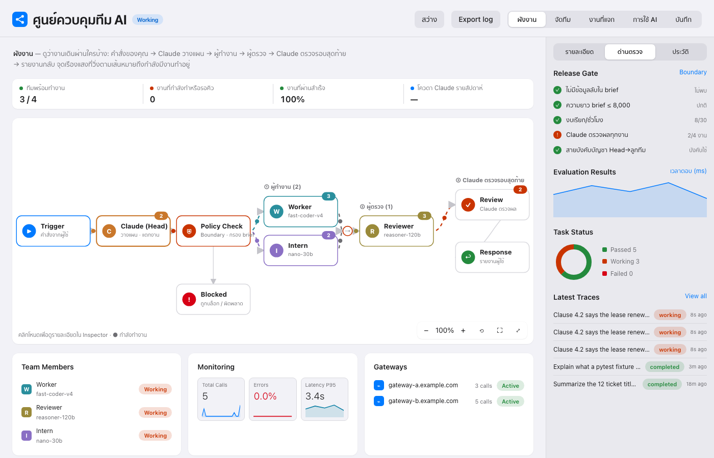 | 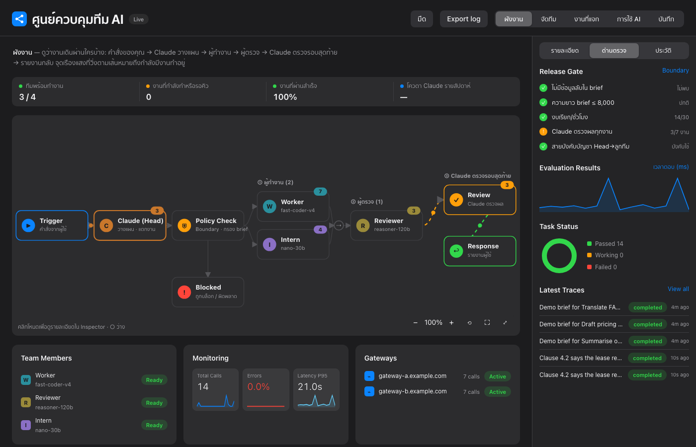 |
| **任务看板** | **任务详情** |
| 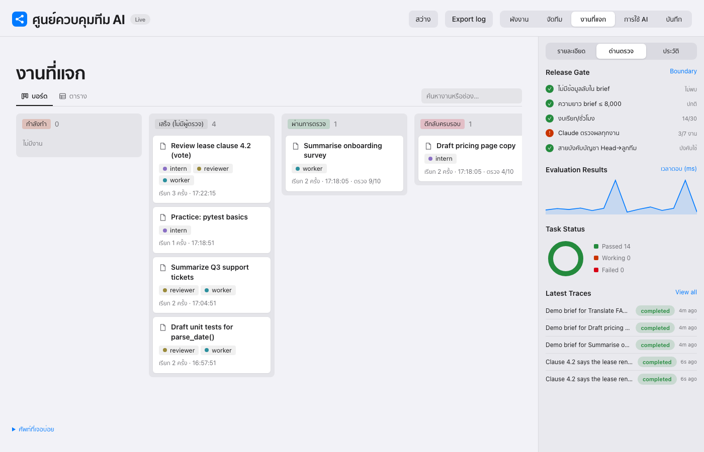 | 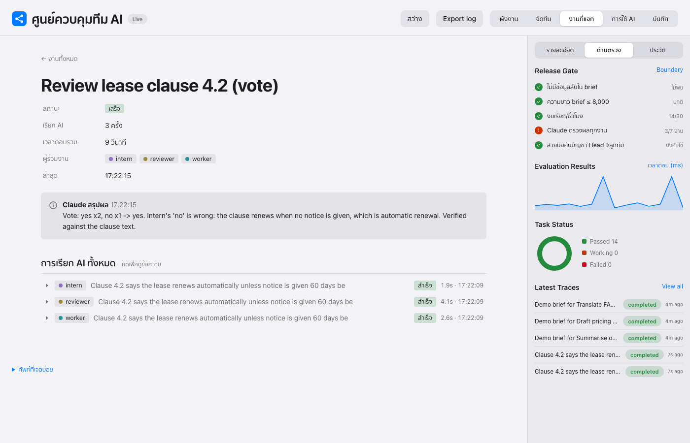 |
| **团队构建器** | **流程检查器** |
| 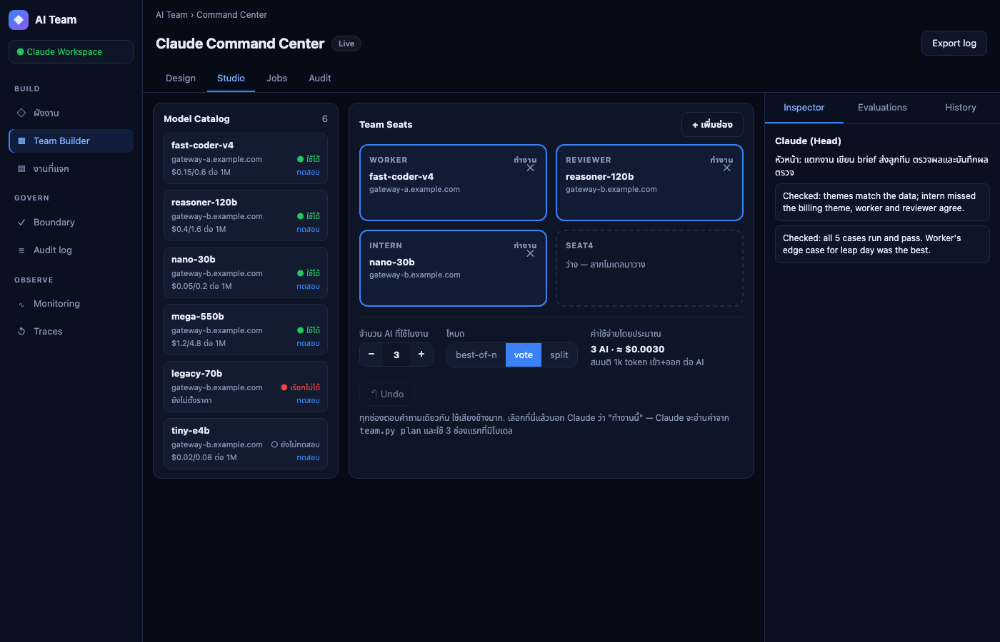 | 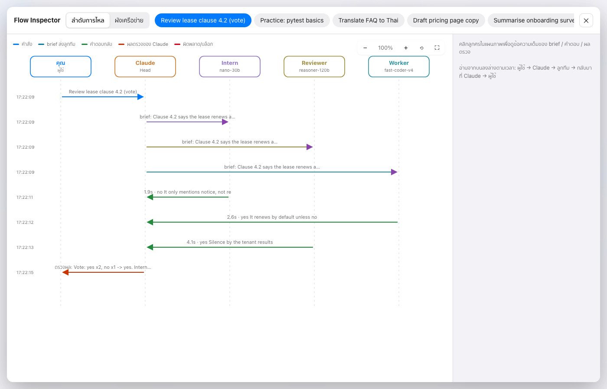 |

## 使用 ChatGPT、Gemini 或 Grok 作为团队成员

支持任何兼容 OpenAI 的服务商，内置 7 个预设：

```bash
python3 scripts/team.py presets                      # 列出预设及密钥环境变量名
python3 scripts/team.py connect gemini               # 隐藏输入密钥，导入 Gemini 模型
python3 scripts/team.py connect openai --seat seat6  # 导入 ChatGPT 模型，第一个放入 seat6
AI_TEAM_KEY_XAI=... python3 scripts/team.py connect xai   # Grok，从环境变量读取密钥
```

| 预设 | 服务商 | 密钥环境变量 |
|---|---|---|
| `openai` | ChatGPT (OpenAI) | `AI_TEAM_KEY_OPENAI` |
| `gemini` | Gemini (Google AI Studio) | `AI_TEAM_KEY_GEMINI` |
| `xai` | Grok (xAI) | `AI_TEAM_KEY_XAI` |
| `groq`、`openrouter`、`nvidia`、`tokenme` | 其他 | `AI_TEAM_KEY_<NAME>` |

连接失败的密钥不会被保存。密钥只存于本地 `team.db`，从不打印。

### 使用电脑上已登录的 AI 订阅（无需 API 密钥）

如果你已登录 AI 编程 CLI，团队可以直接把它当作成员使用，费用计入月度订阅额度，而不是按 token 计费。

```bash
python3 scripts/team.py connect codex-cli --seat seat6     # 通过 Codex CLI 使用 ChatGPT 订阅
python3 scripts/team.py connect agy-cli                    # Antigravity CLI (agy)
python3 scripts/team.py connect claude-cli                 # Claude Code
python3 scripts/team.py connect gemini-cli                 # Gemini CLI
```

每次调用都在空的临时目录中以只读/计划模式运行，不保存会话，成员只能返回文本，不能修改文件。每次一个短任务比共用一个长会话更省，因为会话每轮都会重发全部历史。已知限制：Google 已不再允许个人账号使用 Gemini CLI，建议改用 Antigravity；若 `agy` 设置了自定义 `modelProvider`，需设置该服务商要求的环境变量。

### 用任意 agent CLI 指挥（Antigravity、Gemini CLI、Codex…）

团队就是普通 CLI，任何能运行 shell 命令的 agent 都能担任负责人。让 agent 阅读 [`AGENTS.md`](AGENTS.md)。

## 快速开始
```bash
# 1. 作为 Claude Code 技能安装
git clone https://github.com/panusbodee-owen/Power-Ai-Ranger-Skill.git ~/.claude/skills/ai-team

# 2. 注册团队成员（密钥由你在自己的终端输入，输入时不显示）
python3 ~/.claude/skills/ai-team/scripts/team.py add worker --base-url https://GATEWAY/v1 --model MODEL --role "勤奋的员工"
python3 ~/.claude/skills/ai-team/scripts/team.py add intern --base-url https://GATEWAY/v1 --model MODEL --role "实习生"

# 3. 打开仪表盘
python3 ~/.claude/skills/ai-team/scripts/dash.py   # http://localhost:8790
```
然后打开 Claude Code，直接说，例如“让 worker 给这个函数写测试”。Claude 会规划、分发 brief、审核并汇报。

API 密钥只保存在你本机的 `~/.ai-team/team.db`（不在本仓库中，`*.db` 已被 git 忽略）。

## 成员指南与训练
- `docs/TEAM-GUIDE.md` 与 `docs/team/<名称>.md`：每位成员的系统提示词、辅导文本、示例指令，以及可直接运行的 `curl`/Python 调用，不含 API 密钥。
- `docs/performance-*.md`：训练前后的结果及其局限。模型是托管服务，不涉及微调；这里的“训练”是指辅导提示词加上度量评估。
- 重新生成：`python3 scripts/train.py run && python3 scripts/train.py apply && python3 scripts/train.py report docs/performance-<日期>.md && python3 scripts/train.py guide docs/team`

## 安全
- Claude 不会读取或打印你的 API 密钥，只有脚本使用它们。
- brief 会过滤密钥、密码和 13 位数字；限制长度和每小时调用次数；记录每次调用。
- 仪表盘只绑定 127.0.0.1，并且从不读取密钥列。它可以编辑席位和提交任务，请不要把该端口暴露到网络。
- brief 和密钥会发送到你配置的网关，请选择可信的服务商。

## 状态
早期项目，作者每天都在使用。欢迎提交 Issue 和 Pull Request。

如果它对你有帮助，欢迎给仓库点个 ⭐，让更多人发现它。

## 关键词
Claude Code 技能 · 多智能体编排 · LLM 团队 · 执行者/审核者工作流 · 兼容 OpenAI 的 API · DeepSeek · NVIDIA Nemotron · 通义千问 Qwen · Groq · OpenRouter · AI 仪表盘 · 提示词安全边界
